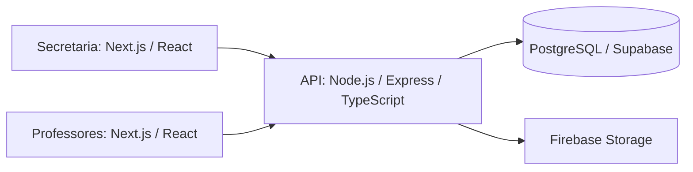

# SEMG.edu - API de gestão escolar

O SEMG.edu é uma solução de gestão escolar implementada por Samuel Oliveira no ambiente da Fábrica Escola de Software MAMBEE/IFPI, com orientações pontuais de professores sobre problemas técnicos e tecnologias.

Foi disponibilizado para usuários reais em uma escola com aproximadamente 200 alunos, 20 professores e uma equipe de gestão e secretaria. **Atualmente não está mais em utilização pela escola.** As métricas de utilização são informações fornecidas pelo autor, não medições extraídas do código.

A solução reúne cadastro de alunos e professores, turmas, matrículas, avaliações, notas e rotinas administrativas. Não implica que todo fluxo esteja completo ou validado automaticamente.

## Solução e arquitetura


- [Backend compartilhado](https://github.com/SamuelOliveira-M/SEMG-Edu-Backend)
- [Aplicação da secretaria](https://github.com/SamuelOliveira-M/semg.edu-nextJS)
- [Aplicação dos professores](https://github.com/SamuelOliveira-M/Semg.edu-TeacherView)

O backend utiliza Node.js, Express, TypeScript, PostgreSQL e Prisma ORM. A organização é MVC com variações: controllers recebem as requisições, casos de uso e classes `Model` concentram regras e persistência, e `src/lib/prisma.ts` fornece o cliente Prisma. Não há mudança de arquitetura nesta revisão.

## Estrutura

```text
src/server.ts             inicialização HTTP, Firebase, rotas e erros
src/routes/               rotas de alunos, escola e professores
src/useCase/              controllers e models por entidade/operação
src/interface/            contratos TypeScript
src/middlewares/          autenticação, upload e validações auxiliares
src/services/             tokens, validações e transformações
src/lib/                  Prisma e configurações auxiliares
src/swagger.json          inventário OpenAPI das rotas existentes
prisma/schema.prisma      modelo relacional
prisma.config.ts          configuração da conexão usada pelo Prisma CLI
tests/                    testes incrementais da proposta
```

## Banco de dados

O schema relaciona escola, endereço, alunos, responsáveis, ano letivo, turmas, matrículas, avaliações, disciplinas, professores, gestores, lotações, horários e calendário. O cliente usa `@prisma/adapter-pg` com `DIRECT_URL`.

O diretório de migrações contém somente `migration_lock.toml`: não há sequência de migrações SQL suficiente para reconstruir o banco. Para um banco **local descartável**, `npx prisma db push` pode criar o schema. Para ambientes compartilhados, primeiro elaborar e revisar uma baseline de migrações. Nunca aplicar esses comandos ao banco histórico da escola.

## Instalação e execução local

Pré-requisitos: Node.js 24 (ambiente validado nesta revisão), npm, PostgreSQL local descartável e um projeto Firebase de desenvolvimento separado.

```bash
git clone https://github.com/SamuelOliveira-M/SEMG-Edu-Backend.git
cd SEMG-Edu-Backend
npm ci --ignore-scripts
```

Copie `.env.example` para `.env` e preencha somente valores locais/de desenvolvimento. No PowerShell: `Copy-Item .env.example .env`.

```bash
npx prisma generate
# Somente após verificar que DIRECT_URL aponta para um banco local descartável:
npx prisma db push
npm run dev
```

A porta padrão é 3333. A documentação fica em `http://localhost:3333/docs`. O servidor inicializa Firebase ao iniciar; sem configuração válida de desenvolvimento, não há garantia de inicialização. Não há modo de demonstração isolado nem seed de administrador seguro implementado.

### Variáveis de ambiente

| Variáveis | Finalidade |
| --- | --- |
| `DIRECT_URL` | Conexão PostgreSQL para CLI e runtime |
| `KEY_TOKEN` | Segredo de assinatura JWT; gerar um valor novo e forte |
| `PORT` | Porta HTTP, padrão 3333 |
| `FIREBASE_STORAGE_BUCKET` | Bucket de desenvolvimento |
| `type`, `project_id`, `private_key_id`, `private_key` | Campos da conta de serviço Firebase |
| `client_email`, `client_id`, `auth_uri`, `token_uri` | Campos da conta de serviço Firebase |
| `auth_provider_x509_cert_url`, `client_x509_cert_url`, `universe_domain` | Metadados de autenticação Firebase |

Nunca versionar `.env`, contas de serviço ou chaves reais. O frontend não deve receber a chave privada Firebase nem `KEY_TOKEN`.

## Autenticação: comportamento existente e pendências

`POST /login` consulta professor e depois gestor, compara a senha com bcrypt e emite JWT HS256 com `userId`, `userName`, `isAdmin`, `sub` e expiração de 120 segundos. O refresh token é persistido no banco por sete dias; `POST /refreshtoken` solicita um novo access token.

O middleware revisado exige `Authorization: Bearer <token>`, verifica assinatura, expiração e claims e responde 503 quando falta `KEY_TOKEN`. **As rotas de negócio ainda não aplicam esse middleware.** Um token verificado também não substitui a autorização por escola/turma/professor.

O login legado devolve hash de senha e `isAdmin` incorreto para gestor. O frontend administrativo usa esse hash para uma segunda comparação; retirar o campo exige migração coordenada dos clientes. O refresh de gestor consulta a tabela de professores. Essas falhas permanecem no plano de correção e impedem recomendar uso em produção.

## API e documentação

`src/swagger.json` substitui a documentação de outro domínio por um inventário das rotas realmente declaradas. Segmentos opcionais são representados com e sem o parâmetro. O contrato de login e os parâmetros de caminho estão documentados; os schemas completos de corpos/respostas das demais operações ainda precisam ser confirmados com testes. Não há promessa de autorização no OpenAPI.

## Qualidade e testes

Historicamente, o sistema foi testado manualmente. Esta proposta acrescenta testes com Vitest/Supertest para o middleware JWT e o tratamento global de erros. Eles usam aplicação Express mínima e dados sintéticos, sem banco, Firebase ou contas reais. **Não representam testes completos das APIs de alunos, matrículas e notas.**

```bash
npm run typecheck
npm run lint
npm test
npm run build
```

O lint inicial cobre erros de sintaxe/fluxo básicos; não representa adoção integral de todas as regras TypeScript. O workflow `quality.yml` verifica instalação, geração do Prisma, tipos, lint, testes e build em pull requests e por acionamento manual. Não contém deploy.

## Limitações conhecidas e próximos passos

1. Aplicar autenticação e autorização por função e vínculo a todos os recursos, migrando os dois frontends para enviar o token.
2. Remover hashes de senha das respostas, corrigir o refresh e eliminar logs de dados pessoais.
3. Restringir CORS; limitar uploads antes de alocar buffers e deixar objetos privados no Storage.
4. Padronizar erros que os controllers capturam internamente; o middleware global não corrige sozinho esses retornos.
5. Corrigir o fluxo de envio de notas, que pode terminar sem resposta HTTP; tratar colisões de matrícula e atomicidade.
6. Adicionar testes de login, autorização, matrículas e notas com banco isolado, além de migrações reproduzíveis.
7. Revisar dependências e compatibilidade antes de atualizar versões.

Não inserir dados reais de alunos nas demonstrações. O histórico de hospedagem inclui Render, Vercel, Supabase e Firebase; isso não assegura que os endereços antigos estejam ativos.

## Autoria e créditos

Samuel Oliveira foi responsável pela implementação do SEMG.edu. A MAMBEE/IFPI forneceu o ambiente acadêmico; Jesiel Viana ofereceu orientação técnica e Aislan Rafael contribuiu com orientações de interface, conforme os créditos históricos do projeto. Orientação acadêmica não é apresentada como autoria da implementação.
